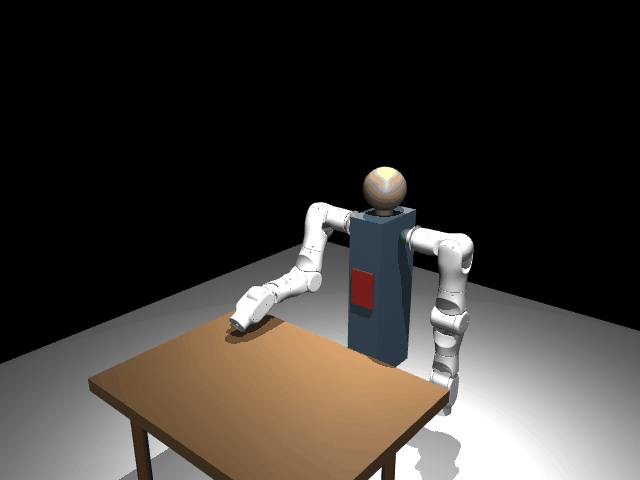
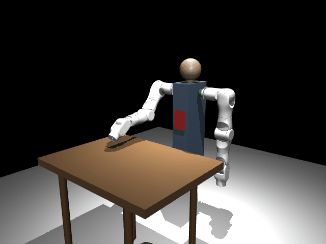
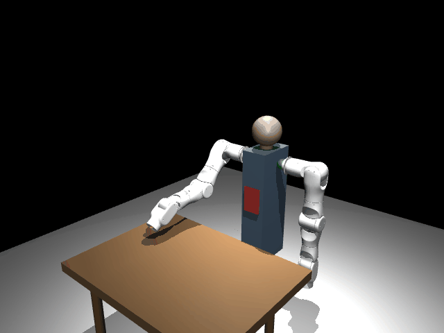
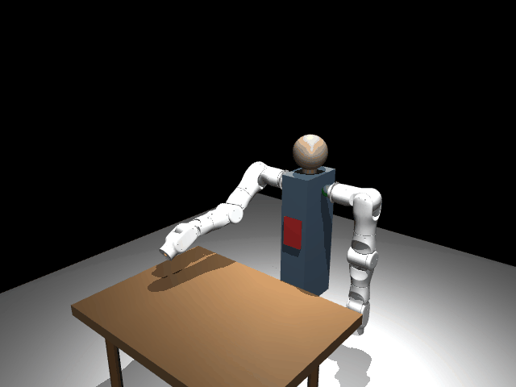
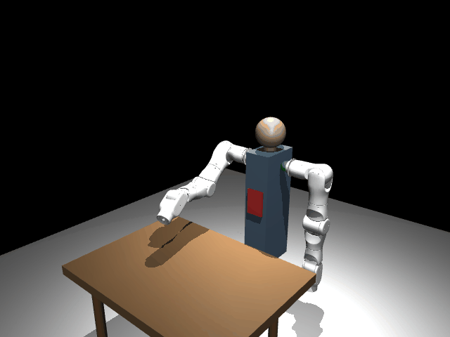
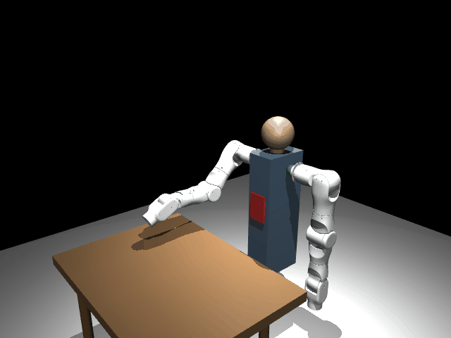
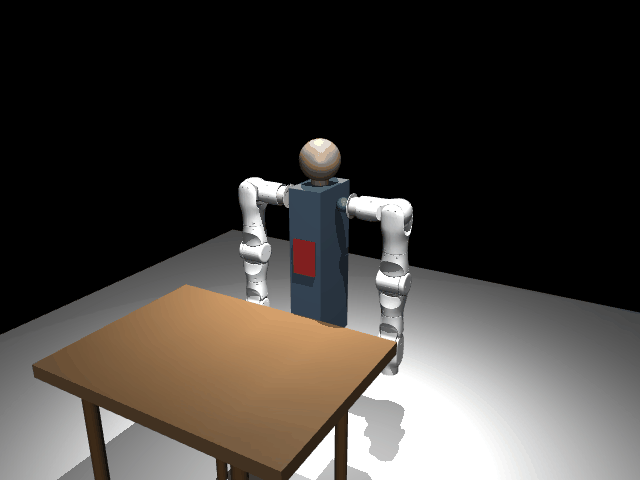

# onero SDK

**[English](README_en.md)** | 中文

用于控制 onero A1 机械臂的 Python SDK。

## 功能特性

- 高级运动 API：`movej`、`movel`、`movep`、`movec`、`servoj`、`servop`
- 多种轨迹曲线：余弦、梯形速度、S 曲线（jerk-limited）
- 速度控制：`speedj`、`speedl`
- 示教模式 / freedrive（基于 pinocchio 重力补偿）
- 力控：混合力/位置模式
- 动力学原语：雅可比矩阵、重力补偿力矩、科氏力力矩
- 动力学参数标定（辨识）
- 运动学标定（单点约束法，提高绝对定位精度）
- 碰撞检测与末端外力估计
- 高级轨迹规划：Ruckig（在线 jerk-limited）、TOPP-RA（时间最优）
- 可配置负载（影响动力学精度）
- 轨迹录制与回放
- 多路点轨迹 + blending 平滑过渡
- 可插拔后端架构（真实 CAN 硬件或 MuJoCo 仿真）
- MuJoCo 双臂仿真（人体躯干 + 桌面场景）
- 末端执行器支持（夹爪、灵巧手）
- 内置安全限制（速度钳位、关节限位、超时保护）
- 模型注册表 — 通过名称和通道即可创建机械臂实例
- 轻量 FK（基于 URDF，无外部依赖）
- 可选 IK（pinocchio / pink）
- 直接 SocketCAN 通信

## 安装

```bash
pip install -e .              # 核心（CAN + FK + 电机控制）
pip install -e ".[ik]"        # + 逆运动学（pinocchio、pink）
pip install -e ".[dynamics]"  # + 动力学（示教模式、力控）
pip install -e ".[sim]"       # + MuJoCo 仿真
pip install -e ".[trajectory]" # + 高级规划（Ruckig、TOPP-RA）
pip install -e ".[full]"      # 全部安装
```

## 快速开始

### 关节运动（movej）

**特性说明**：`movej` 是最基础的运动指令，控制机械臂各关节同时运动到目标角度。轨迹在关节空间中规划，所有关节同步到达目标。

**适用场景**：当你只关心最终的关节角度，而不需要控制末端走特定路径时使用。例如：从一个工位快速移动到另一个工位、回零位、预备姿态切换等。

**Demo 演示**：机械臂从初始位置运动到指定关节角度，展示平滑的关节空间插值过程。

<p align="center"></p>

```python
from onero_sdk import Arm

with Arm("A1R", channel="can0") as arm:
    # 指定运动时间
    arm.movej([0.0, 0.5, 0.0, -0.3, 0.0, 0.0, 0.0], duration=3.0)

    # 或指定速度/加速度（UR 兼容风格）
    arm.movej([0.3, 0.8, 0.0, -0.5, 0.0, 0.0, 0.0], speed=1.5, acceleration=1.4)

    arm.home()
```

### 末端直线运动（movel）

**特性说明**：`movel` 控制末端执行器沿笛卡尔空间的直线移动到目标位姿。内部通过逆运动学实时解算关节角度，确保末端路径为精确直线。

**适用场景**：当末端路径必须为直线时使用。例如：涂胶、点焊、装配插入、搬运时的平移阶段、以及任何需要精确控制末端轨迹的场合。

**Demo 演示**：末端从当前位置沿直线移动到目标点，轨迹清晰可见为一条直线。

<p align="center"></p>

```python
import numpy as np
from onero_sdk import Arm

with Arm("A1R", channel="can0") as arm:
    # 指定时间
    arm.movel(position=[0.3, 0.0, 0.2], rotation=np.eye(3), duration=3.0)

    # 指定末端速度 (m/s) — 自动计算运动时间
    arm.movel([0.3, 0.1, 0.3, 0, 0, 0], speed=0.25, acceleration=1.2)
```

### 实时伺服控制（servoj）

**特性说明**：`servoj` 是非阻塞的实时关节控制接口，每调用一次发送一帧目标角度。以控制频率（如 100Hz/200Hz）持续调用，可实现任意自定义轨迹。

**适用场景**：当你需要自行计算轨迹并逐帧下发时使用。例如：视觉伺服跟踪、力反馈实时调整、自定义插值算法、与外部传感器闭环控制等。这是最灵活的底层控制接口。

**Demo 演示**：通过正弦函数实时计算关节角度，末端画出一条清晰的正弦波轨迹。

<p align="center"></p>

```python
import time, math
from onero_sdk import Arm

arm = Arm("A1R", channel="can0")
arm.enable()

try:
    for step in range(500):
        t = step / 100.0
        joints = [0.0] * 7
        joints[1] = 0.5 * math.sin(2 * math.pi * 0.5 * t)
        arm.servoj(joints)
        time.sleep(1/100)
finally:
    arm.disable()
```

### 速度控制（speedj / speedl）

**特性说明**：`speedj` 和 `speedl` 分别控制关节速度和笛卡尔速度。指定目标速度后，机械臂以设定的加速度平滑加速到目标速度，到达指定时间后减速停止。

**适用场景**：当你需要控制运动速度而非位置时使用。例如：传送带跟踪（匹配传送带速度）、连续进给加工、恒速扫描、以及需要速度同步的协作任务。

**Demo 演示**：关节以恒定速度运动，展示带加速/减速斜坡的速度控制效果。

<p align="center"></p>

```python
from onero_sdk import Arm

with Arm("A1R", channel="can0") as arm:
    # 关节1以0.5 rad/s运动3秒（带加速斜坡）
    arm.speedj([0.0, 0.5, 0.0, 0.0, 0.0, 0.0, 0.0], acceleration=1.0, duration=3.0)

    # 笛卡尔速度（需要dynamics）
    arm.speedl([0.0, 0.0, -0.05, 0.0, 0.0, 0.0], acceleration=0.5, duration=2.0)
```

### 示教模式（freedrive）+ 录制回放

**特性说明**：示教模式通过重力补偿让机械臂"失重"，用户可以徒手拖动机械臂到任意位姿。配合录制/回放功能，实现"教一遍、做一遍"的编程方式。支持约束示教（仅允许指定方向运动）和变速回放。

**适用场景**：当任务轨迹复杂、难以用坐标描述时使用。例如：工艺动作示教（喷涂路径、打磨轨迹）、柔性装配路径规划、机器人学习数据采集、以及非专业人员快速编程。

**Demo 演示**：先进入示教模式录制一段轨迹，然后以原速回放，再以 2 倍速回放，三段轨迹对比展示录制回放的精确性。

<p align="center"></p>

```python
import time
from onero_sdk import Arm

arm = Arm("A1R", channel="can0")
arm.enable()

# 示教模式下录制（全轴自由）
arm.start_recording()
arm.freedrive_enable(damping=0.3)
time.sleep(10.0)  # 用户引导机械臂
arm.freedrive_disable()
recording = arm.stop_recording()

# 保存并回放
recording.save("trajectory.json")
arm.replay(recording, speed_factor=1.0)

# 约束示教：只允许 Z 轴方向移动
arm.freedrive_enable(damping=0.5, free_axes=[0, 0, 1, 0, 0, 0])

arm.disable()
```

### 多段轨迹融合（blending）

**特性说明**：Blending 允许多个路点之间无停顿地平滑过渡。机械臂不会在每个路点停下来再启动，而是用五次多项式在路点附近做平滑过渡，保证速度和加速度连续。支持直线段、圆弧段、甚至实时伺服段之间的无缝衔接。

**适用场景**：当需要多段连续运动且不希望中间停顿时使用。例如：焊接路径（多段焊缝连续走完）、喷涂轨迹（转角处不能停顿）、搬运码垛（多个工位之间流畅切换）、以及任何对节拍时间敏感的生产线应用。

**Demo 演示**：展示直线→圆弧→直线的三段连续运动，路点之间平滑过渡无停顿。

<p align="center"></p>

```python
from onero_sdk import Arm, TrajectoryPlanner, Waypoint

planner = TrajectoryPlanner(num_joints=7, control_freq=100.0)
planner.add_waypoint(Waypoint(joints=[0.0, 0.5, 0.0, -0.3, 0.0, 0.0, 0.0], duration=2.0, blend=0.3))
planner.add_waypoint(Waypoint(joints=[0.3, 0.8, 0.2, -0.5, 0.0, 0.1, 0.0], duration=2.0, blend=0.3))
planner.add_waypoint(Waypoint(joints=[0.0, 0.0, 0.0, 0.0, 0.0, 0.0, 0.0], duration=2.0))

with Arm("A1R", channel="can0") as arm:
    frames = planner.compute(arm.state.joints)
    arm.execute_trajectory(frames)
```

### 力控模式（force_mode）

**特性说明**：`force_mode` 实现混合力/位置控制。你可以指定某些方向为力控（施加恒定力），其他方向保持位置控制。力控方向会持续施加指定大小的力，同时位置方向保持不动。

**适用场景**：当末端需要与环境接触并保持恒定力时使用。例如：打磨抛光（保持恒定压力）、装配按压（施加特定插入力）、表面探测（以小力接触表面确定位置）、去毛刺（沿表面滑动同时保持法向力）。

**Demo 演示**：末端在 Z 方向施加向下的力直到接触表面，然后在 X/Y 方向滑动同时保持恒力，展示力控的效果。

<p align="center"></p>

```python
import time
from onero_sdk import Arm

arm = Arm("A1R", channel="can0")
arm.enable()

try:
    # 在z方向施加10N向下力，x/y保持位置
    # task_frame: 力方向的参考坐标系 [x, y, z, rx, ry, rz]
    # limits: 力控方向的速度上限 (m/s, rad/s)
    for _ in range(1000):
        arm.force_mode(
            selection=[0, 0, 1, 0, 0, 0],       # z = 力控
            wrench=[0, 0, -10.0, 0, 0, 0],       # 10N向下
            task_frame=[0, 0, 0, 0, 0, 0],       # 基坐标系
            limits=[0, 0, 0.1, 0, 0, 0],         # z方向最大0.1 m/s
        )
        time.sleep(1/100)

    arm.force_mode_disable()
finally:
    arm.disable()
```

### 圆弧运动（movec）

**特性说明**：`movec` 控制末端执行器沿圆弧路径运动。通过三点确定一个圆弧：起点（当前位姿）、途经点（via）和终点（target）。内部通过逆运动学实时解算，确保末端精确走圆弧。

**适用场景**：当末端路径必须为圆弧时使用。例如：弧焊（焊接圆弧接缝）、抛光圆弧面、圆形轨迹涂胶、管道跟踪、以及任何需要曲线运动的加工场景。

**Demo 演示**：末端沿一段清晰的圆弧路径运动，展示三点定弧的精确圆弧轨迹。

<p align="center"></p>

```python
from onero_sdk import Arm

arm = Arm("A1R", channel="can0")
arm.enable()

try:
    # 末端沿圆弧运动
    # 位姿格式: [x, y, z, rx, ry, rz]（米，旋转向量，单位rad）
    via_pose = [0.3, 0.1, 0.4, 0, 0, 0]
    target_pose = [0.3, -0.1, 0.4, 0, 0, 0]

    arm.movec(via_pose, target_pose, duration=3.0)
finally:
    arm.disable()
```

### 碰撞检测

**特性说明**：实时监测各关节力矩是否超过预期值，超过阈值判定为碰撞并触发保护动作。基于动力学模型计算预期力矩，与实际力矩的差异即为外部接触力。

**适用场景**：当机械臂在共享工作空间中运动、可能与人或障碍物接触时使用。例如：人机协作场景的安全防护、未知环境中的自主探索、以及防止工件或工具损坏。

```python
from onero_sdk import Arm
from onero_sdk.safety import SafetyConfig

# 配置碰撞阈值 (Nm)
safety = SafetyConfig(collision_threshold=5.0, collision_stop=True)
arm = Arm("A1R", channel="can0", safety=safety)
arm.enable()

# 手动检查（collision_stop=False 时有用）
collision = arm.check_collision()
if collision:
    print("检测到外部接触!")
```

### 负载配置

**特性说明**：告知 SDK 末端安装了多重的工具/工件，动力学模型会据此修正重力补偿和碰撞检测的基线。

**适用场景**：当末端安装了夹爪、工具或抓取了工件后，需要更新负载参数以保证示教模式手感自然、碰撞检测准确。

```python
from onero_sdk import Arm

arm = Arm("A1R", channel="can0")
arm.enable()

# 设置工具负载以提高动力学精度
# （影响示教模式、碰撞检测、外力估计）
arm.set_payload(mass=0.5, cog=[0.0, 0.0, 0.05])
```

### 末端外力估计

**特性说明**：基于动力学模型估算末端执行器受到的六维外力/力矩。无需额外力传感器，通过电机电流与动力学预测的差值推算外力。

**适用场景**：当需要感知末端接触力但未安装力传感器时使用。例如：接触检测（判断是否碰到工件）、力控的反馈信号、以及简易的力引导交互。

```python
from onero_sdk import Arm

arm = Arm("A1R", channel="can0")
arm.enable()

# 估计末端执行器受到的外力/力矩
wrench = arm.get_external_wrench()
# wrench = [fx, fy, fz, tx, ty, tz]，单位 N 和 Nm
print(f"力: {wrench[:3]}, 力矩: {wrench[3:]}")
```

### 阻抗控制（动力学原语）

**特性说明**：SDK 提供雅可比矩阵、重力补偿力矩、科氏力力矩等动力学原语，可以直接用于实现笛卡尔空间阻抗控制。阻抗控制让机械臂像弹簧一样响应外力——被推开后自动回弹，刚度可调。

**适用场景**：当需要机械臂与环境柔性交互时使用。例如：柔顺装配（允许一定位置偏差以适应零件公差）、人机协作中的安全柔顺响应、打磨/擦拭等需要力自适应的任务、以及任何需要自定义动力学行为的高级控制。

**Demo 演示**：机械臂以低刚度保持目标位姿，受到外力扰动后产生明显偏移并自动恢复，展示弹簧般的柔顺特性。

<p align="center"></p>

```python
import numpy as np
from onero_sdk import Arm

arm = Arm("A1R", channel="can0")
arm.enable()

# 末端雅可比矩阵 (6x7)，世界坐标系
J = arm.jacobian()

# 重力补偿力矩
g = arm.gravity_torque()

# 科氏力 + 离心力力矩（静止时约为零）
c = arm.coriolis_torque()

# 示例：笛卡尔空间阻抗控制
Kp = np.diag([200, 200, 200, 50, 50, 50])
Kd = np.diag([20, 20, 20, 5, 5, 5])
x_error = x_desired - x_current   # 6D 位姿误差
dx_error = dx_desired - dx_current # 6D 速度误差
F = Kp @ x_error + Kd @ dx_error
tau = J.T @ F + np.array(g)
arm.servoj(arm.state.joints, kp=0, kd=0, tau_ff=tau.tolist())
```

### 7自由度零空间运动

**特性说明**：A1 是一款 7 自由度机械臂，在 6 维任务空间（3平移 + 3旋转）下有 1 个冗余自由度。零空间运动利用这个冗余度：在末端执行器位姿完全不变的前提下，重新配置臂部姿态。通过雅可比矩阵的零空间投影实现——任何投影到零空间的关节速度都不会引起末端运动。

**适用场景**：当需要在保持末端不动的同时调整臂姿时使用。例如：避障（绕开工作空间中的障碍物）、避奇异（远离奇异位形提高操作性能）、优化关节裕度（远离关节极限）、多臂协作时避免自碰撞、以及在狭窄空间中调整姿态。

**Demo 演示**：末端执行器（绿点）保持完全静止，而肘部（品红色轨迹）大范围运动超过 200mm，直观展示 7 自由度的冗余特性——同一个末端位姿对应无数种臂部构型。

<p align="center"></p>

```python
import numpy as np
from onero_sdk import Arm

arm = Arm("A1R", channel="can0")
arm.enable()

dynamics = arm._get_dynamics()
fk = arm._get_fk()
ik = arm._get_ik()

# 锁定当前末端位姿作为目标
ee_target_pos, ee_target_rot = fk.get_ee_pose(arm.state.joints)
q_current = np.array(arm.state.joints)

# 零空间激励方向
q_excite = np.array([0.4, -0.3, 1.2, 0.3, -1.0, 0.15, 0.6])
dt = 0.005

for step in range(3000):
    t = step * dt
    amplitude = 4.0 * np.sin(2 * np.pi * 0.12 * t)

    # 计算零空间投影: N = I - J_pinv @ J
    J = dynamics.jacobian(list(q_current))
    J_pinv = np.linalg.pinv(J)
    N = np.eye(7) - J_pinv @ J
    dq_null = N @ (q_excite * amplitude)

    q_candidate = q_current + dq_null * dt

    # IK 修正：确保末端精确回到目标位姿
    ik.reset(q_candidate)
    q_current = np.array(ik.solve(ee_target_pos, ee_target_rot, dt=dt))

    arm.servoj(list(q_current))

arm.disable()
```

### 动力学参数标定

**特性说明**：通过在多个静止构型下采集力矩数据，辨识每个关节的摩擦参数和负载偏移，修正动力学模型。标定后重力补偿、碰撞检测和外力估计的精度显著提升。

**适用场景**：新机械臂首次投入使用时、更换关节/减速器后、或发现示教模式有明显"漂移"时执行一次标定。通常只需做一次，结果可持久保存。

```python
from onero_sdk import Arm

arm = Arm("A1R", channel="can0")
arm.enable()

# 标定动力学参数（提高重力补偿精度）
result = arm.calibrate_dynamics(num_configs=40, settle_time=0.5)
print(f"RMS 残差: {result.residual_rms:.4f} Nm")
print(f"库仑摩擦: {result.friction_coulomb}")

# 标定后，示教模式 / 外力估计精度显著提升
arm.disable()
```

### 运动学标定（提高绝对定位精度）

**特性说明**：通过从不同关节构型触碰同一个已知参考点，解算关节偏移和连杆参数误差。标定后 FK/IK 的绝对定位精度可从毫米级提升到亚毫米级。

**适用场景**：当需要高绝对定位精度时使用。例如：多臂协作（两臂坐标系必须对齐）、视觉引导抓取（相机标定后末端必须准确到达指定坐标）、精密装配。

```python
from onero_sdk import Arm, KinematicCalibrator

arm = Arm("A1R", channel="can0")
arm.enable()

# 从不同构型触碰同一个固定参考点（如桌角）
calibrator = KinematicCalibrator.from_arm(arm)
for i in range(20):
    input(f"触碰参考点（第 {i+1}/20 次），按 Enter 记录")
    calibrator.record_touch(arm=arm)

# 解算运动学修正
result = calibrator.solve()
print(f"残差: {result.residual_mm:.2f} mm")
result.save("kinematic_cal.json")

# 应用修正 — 后续所有 FK/IK 使用校正后的参数
arm.apply_kinematic_calibration(result)

arm.disable()
```

### 高级轨迹规划

**特性说明**：SDK 支持多种工业级轨迹曲线。梯形速度曲线是工业标准（匀加速→匀速→匀减速）；S 曲线限制加加速度（jerk），运动更平滑；Ruckig 支持在线实时改变目标；TOPP-RA 计算时间最优轨迹。

**适用场景**：当需要精确控制运动的速度曲线或优化运动时间时使用。例如：高速搬运需要梯形曲线保证效率、精密操作需要 S 曲线减少振动、动态跟踪需要 Ruckig 在线重规划、多路点最短时间需要 TOPP-RA 全局优化。

**Demo 演示**：展示梯形速度曲线的大幅关节运动，清晰可见加速-匀速-减速三段。

<p align="center"></p>

```python
from onero_sdk import Arm, TrapezoidalProfile, RuckigPlanner, TimeOptimalPlanner

arm = Arm("A1R", channel="can0")
arm.enable()

# 1. 梯形 / S 曲线（内置，无额外依赖）
arm.movej(target, speed=2.0, acceleration=5.0)                # 梯形（自动）
arm.movej(target, speed=2.0, acceleration=5.0, profile='s_curve')  # jerk-limited

# 2. Ruckig — 在线 jerk-limited（pip install ruckig）
planner = RuckigPlanner(num_joints=7)
planner.set_limits(v_max=[2.5]*7, a_max=[5.0]*7, j_max=[30.0]*7)
frames = planner.plan(start, target, dt=0.01)
arm.execute_trajectory(planner.to_trajectory_frames(frames, dt=0.01))

# 3. TOPP-RA — 时间最优多路点（pip install toppra）
opt = TimeOptimalPlanner(num_joints=7)
opt.set_velocity_limits([2.5]*7)
opt.set_acceleration_limits([5.0]*7)
frames = opt.plan(waypoints, dt=0.01)  # 约束内最快轨迹
arm.execute_trajectory(frames)

arm.disable()
```

### MuJoCo 仿真

**特性说明**：SDK 的后端架构完全可插拔。MuJoCo 仿真后端提供与真实硬件后端相同的接口——所有上层 API（movej、movel、force_mode 等）无需修改即可在仿真中运行。开发、调试、验证全部可以在仿真中完成，上线时只需切换后端。

**适用场景**：开发调试阶段无需连接真实机械臂；算法验证和参数调优；教学演示；CI/CD 自动化测试。

```python
from onero_sdk.dual_mujoco_backend import DualMujocoBackend
import mujoco.viewer

# 双臂仿真：人体躯干 + 桌面场景
backend = DualMujocoBackend(model_name='A1', realtime=True)
viewer = mujoco.viewer.launch_passive(backend._model, backend._data)
backend._viewer = viewer

# 对称运动：反号 = 镜像动作
import numpy as np
r_forward = np.array([1.5, 0, 0, 0, 0, 0, 0])
l_forward = -r_forward  # 镜像
backend.movej(r_forward, l_forward, duration=2.0)
```

### 双臂控制

**特性说明**：`DualArm` 封装了双臂协调控制，两条臂共享时间同步、安全监控和生命周期管理。支持对称运动、独立运动和协调运动。

**适用场景**：当需要两条臂配合完成任务时使用。例如：双臂协作搬运大型工件、一臂固定一臂操作、对称动作（如拧瓶盖）、以及需要臂间避碰的复杂任务。

**Demo 演示**：两条臂执行镜像对称运动，展示双臂同步协调。

<p align="center"></p>

```python
from onero_sdk import DualArm

with DualArm.create("A1R", left_channel="can0", right_channel="can1") as dual:
    dual.movej(
        left_joints=[0.0, 0.5, 0.0, -0.3, 0.0, 0.0, 0.0],
        right_joints=[0.0, -0.5, 0.0, 0.3, 0.0, 0.0, 0.0],
        duration=3.0,
    )
```

### 末端执行器（夹爪 / 灵巧手）

**特性说明**：SDK 提供抽象接口（`Gripper`、`DexterousHand`），将末端执行器的生命周期与机械臂绑定。只需实现通信协议，即可享受自动 enable/disable 管理和统一的 API 风格。

**适用场景**：当末端安装了夹爪或灵巧手时使用。SDK 不限定具体硬件，通过继承抽象基类适配任意协议（CAN、RS485、EtherCAT 等）。

```python
from onero_sdk import Arm, Gripper
from onero_sdk.can_bus import CanBus

class MyGripper(Gripper):
    def __init__(self, bus, can_id=0x08):
        self._bus = bus
        self._can_id = can_id
        self._pos = 0xFF

    def enable(self):    self.open()
    def disable(self):   pass
    def shutdown(self):  pass
    def open(self):      self._send(0xFF)
    def grasp(self):     self._send(0x00)
    def set_position(self, position: float):
        self._send(int(position * 0xFF))
    def get_position(self) -> float:
        return self._pos / 0xFF
    def _send(self, pos):
        data = bytes([0x00, pos, 0xFF, 0x80, 0xFF, 0xFF, 0x00, 0x00])
        self._bus.send(self._can_id, data)
        self._pos = pos

# 挂载到机械臂 — enable/disable 自动管理
bus = CanBus("can0")
gripper = MyGripper(bus, can_id=0x08)

with Arm("A1R", channel="can0", end_effector=gripper) as arm:
    arm.movej([0.0, 0.8, 0.0, -1.0, 0.0, 0.5, 0.0], duration=2.0)
    arm.gripper.open()
    arm.movej([0.0, 1.0, 0.0, -1.2, 0.0, 0.5, 0.0], duration=1.5)
    arm.gripper.grasp()
```

完整抓取工作流参见 `examples/gripper_pick_place.py`。

## 硬件配置

### 1. USB-CAN 适配器权限（一次性配置）

```bash
sudo cp configs/99-onero-can.rules /etc/udev/rules.d/
sudo udevadm control --reload-rules && sudo udevadm trigger
sudo usermod -aG dialout,plugdev $USER
sudo setcap cap_net_admin+ep $(which slcand)
sudo setcap cap_net_admin+ep $(which ip)
# 注销后重新登录
```

### 2. 启动 CAN 接口

```bash
# 使用提供的脚本：
# 用法: onero-can-up.sh [device] [channel] [bitrate]
#   device:  串口设备路径（默认: /dev/ttyACM0）
#   channel: CAN 接口名称（默认: can0）
#   bitrate: slcand 速率标志（默认: s8 = 1Mbit/s）
#            s4=125k, s5=250k, s6=500k, s7=800k, s8=1M
sudo bash configs/onero-can-up.sh                           # 默认: /dev/ttyACM0 can0 s8
sudo bash configs/onero-can-up.sh /dev/ttyACM1 can1 s8     # 第二条臂使用 can1

# 或者手动操作:
sudo slcand -o -s8 /dev/ttyACM0 can0 && sudo ip link set up can0
```

## 配置文件

最小配置 (`configs/a1.yaml`):

```yaml
model: "A1R"
channel: "can0"
```

或在代码中直接创建：

```python
arm = Arm("A1R", channel="can0")
arm = Arm.from_config("configs/a1.yaml")
```

## 架构

```
onero_sdk/
├── arm.py              # 高级 API（movej/movel/speedj/freedrive/force_mode/...）
├── dual_arm.py         # DualArm 双臂便利封装
├── backend.py          # ArmBackend 抽象基类（可插拔传输层）
├── can_backend.py      # CAN 硬件后端实现
├── safe_backend.py     # SafeBackend 装饰器 — 在后端接缝透明施加安全钳位
├── motion_executor.py  # MotionExecutor — 帧生成器的统一控制循环
├── clock.py            # ControlClock — 基于截止时间的定时器，带漂移补偿
├── geometry.py         # 纯数学函数（SLERP、旋转向量、圆拟合、Rodrigues）
├── end_effector.py     # EndEffector / Gripper / DexterousHand 抽象基类
├── trajectory.py       # 录制、TrajectoryPlanner、blending（五次多项式）
├── trajectory_profiles.py # 梯形、S 曲线、五次多项式过渡曲线
├── ruckig_planner.py   # 在线 jerk-limited 轨迹（Ruckig）[可选]
├── toppra_planner.py   # 时间最优路径参数化（TOPP-RA）[可选]
├── dynamics.py         # 动力学模型（pinocchio RNEA + 雅可比）[可选]
├── calibration.py      # 动力学参数辨识 [可选]
├── kinematic_calibration.py # 运动学标定（单点约束法）[可选]
├── mujoco_backend.py   # 单臂 MuJoCo 仿真后端 [可选]
├── dual_mujoco_backend.py # 双臂 MuJoCo 仿真（人体躯干）[可选]
├── fk.py              # 轻量 FK（仅 numpy，从 URDF 解析）
├── ik_solver.py        # IK: DLS (pinocchio) + QP (pink) [可选]
├── safety.py           # 安全限制与超时保护
├── model_registry.py   # 机械臂模型 → 关节配置查询
├── exceptions.py       # OneroError 异常体系
├── protocol.py         # CAN 帧编解码
├── can_bus.py          # SocketCAN 原始套接字
├── motor.py            # 单电机控制器（底层）
└── config.py           # YAML 配置加载
```

## 运动 API

| 命令 | 空间 | 模式 | 阻塞 | 用途 |
|------|------|------|------|------|
| `movej` | 关节 | 位置 | 是 | 快速关节运动 |
| `movel` | 笛卡尔 | 位置 | 是 | 直线运动（装配、涂胶） |
| `movep` | 笛卡尔 | 位置 | 是 | 到达位姿，路径任意 |
| `movec` | 笛卡尔 | 位置 | 是 | 圆弧运动（焊接、抛光） |
| `speedj` | 关节 | 速度 | 是 | 恒定关节速度 |
| `speedl` | 笛卡尔 | 速度 | 是 | 恒定末端速度 |
| `servoj` | 关节 | 实时 | 否 | 实时关节控制 |
| `servop` | 笛卡尔 | 实时 | 否 | 实时笛卡尔控制 |
| `freedrive_step` | — | 力矩 | 否 | 手动引导（逐帧） |
| `force_mode` | 笛卡尔 | 力控 | 否 | 混合力/位置控制 |

运动指令（`movej`、`movel`、`movec`、`movep`）支持两种参数风格：
- **时间风格**：`arm.movej(target, duration=3.0)` — 指定总运动时间
- **速度风格**（UR 兼容）：`arm.movej(target, speed=1.5, acceleration=1.4)` — 指定最大速度，自动根据梯形速度曲线计算运动时间

默认曲线为**梯形速度曲线**（行业标准）。使用 `profile='cosine'` 恢复旧版行为，或 `profile='s_curve'` 获得 jerk-limited 平滑运动。

## 底层 API

用于硬件调试或自定义控制模式：

```python
from onero_sdk import CanBus, Motor, MotorLimits

with CanBus("can0") as bus:
    motor = Motor(bus, can_id=0x01, mst_id=0x11,
                  limits=MotorLimits(p_max=12.5, v_max=30.0, t_max=15.0))
    motor.enable()
    state = motor.set_mit(position=1.0, kp=50.0, kd=1.0)
    motor.disable()
```

## 依赖

- **必需**：`numpy`、`pyyaml`
- **可选（IK）**：`pin`（pinocchio）、`pink`
- **可选（动力学）**：`pin`（pinocchio）— 用于示教模式、力控、speedl
- **可选（轨迹规划）**：`ruckig`、`toppra` — Ruckig 和 TOPP-RA 高级规划
- **可选（仿真）**：`mujoco`
- **系统要求**：Linux + SocketCAN 支持

## 测试

```bash
# 协议单元测试（无需硬件）
python3 tests/test_protocol.py

# 虚拟 CAN 集成测试
sudo ip link add dev vcan0 type vcan && sudo ip link set up vcan0
python3 -c "from onero_sdk import Arm; arm = Arm('A1', channel='vcan0'); print('OK')"
```

## 诊断工具

运行内置诊断工具验证配置：

```bash
python -m onero_sdk.diag          # 默认检查 can0
python -m onero_sdk.diag can1     # 检查指定接口
```

检查项目：CAN 接口状态、URDF 文件、pinocchio/pink 可用性。

## 日志

SDK 使用 Python 标准 `logging` 模块。启用 debug 输出可查看控制循环内部、CAN 帧时序和安全监控器活动：

```python
import logging
logging.basicConfig(level=logging.DEBUG)

# 或仅启用 SDK 日志:
logging.getLogger("onero_sdk").setLevel(logging.DEBUG)
```

日志级别：
- `DEBUG`：逐帧时序、CAN 帧详情
- `INFO`：生命周期事件（enable/disable）、运动开始/结束
- `WARNING`：CAN 帧丢失（低于阈值）、接近限位
- `ERROR`：急停触发、硬件故障

## 示例

完整的示例索引和使用场景说明见 **[examples/README.md](examples/README.md)**。

四层使用方式均有覆盖：

| 层级 | 示例 | 说明 |
|------|------|------|
| SDK 直接调用 | `examples/01_*.py` ~ `14_*.py` | 从入门到进阶：仿真、运动、力控、伺服、坐标系、手眼标定 |
| ROS2 | `examples/ros2/` | 话题订阅、服务调用、轨迹执行 |
| MoveIt | `examples/moveit/` | 关节规划、笛卡尔路径、Pick & Place |
| LeRobot | `examples/lerobot/` | 遥操作、数据采集、策略推理、跨臂控制 |

其他独立示例：

- `examples/basic_movej.py` — 关节运动
- `examples/basic_movel.py` — 笛卡尔直线运动
- `examples/servo_control.py` — 实时 100Hz 伺服循环
- `examples/speed_control.py` — 速度模式（speedj）
- `examples/freedrive_teach.py` — 示教 + 录制 + 回放
- `examples/blending.py` — 多路点轨迹 + blending
- `examples/gripper_pick_place.py` — 机械臂 + 夹爪抓取
- `examples/dual_arm.py` — 双臂控制
- `examples/mit_control.py` — 底层单电机 MIT 控制
- `examples/position_control.py` — 位置-速度模式
- `examples/calibration_demo.py` — 动力学参数辨识（MuJoCo 仿真）
- `examples/kinematic_calibration_demo.py` — 运动学标定（单点约束法）
- `examples/trajectory_planning_demo.py` — 轨迹规划对比（梯形、S曲线、Ruckig、TOPP-RA）
- `examples/mujoco_trajectory_comparison.py` — MuJoCo 轨迹验证（自动化正确性检查）

## ROS2 / MoveIt2 / LeRobot 集成

本项目支持三种主流框架集成，详细使用指南如下：

| 框架 | 使用指南 | 适用场景 |
|------|----------|----------|
| **ROS2** | [docs/guide_ros2.md](docs/guide_ros2.md) | 多机器人协作、ROS 生态工具链 |
| **MoveIt2** | [docs/guide_moveit.md](docs/guide_moveit.md) | 碰撞避障、复杂运动规划 |
| **LeRobot** | [docs/guide_lerobot.md](docs/guide_lerobot.md) | 遥操作、数据采集、AI 策略训练/推理 |

快速启动：

```bash
# ROS2 — 驱动节点
cd ros2 && colcon build && source install/setup.bash
ros2 launch onero_ros2 bringup.launch.py can_channel:=can0

# MoveIt2 — 运动规划
ros2 launch onero_moveit_config move_group.launch.py

# LeRobot — 遥操作
pip install -e lerobot/lerobot_robot_onero
pip install -e lerobot/lerobot_teleoperator_onero
lerobot-teleoperate --robot.type=onero --robot.can_channel=can0 \
    --teleop.type=onero_teleop --teleop.leader_channel=can1
```

详见 [`ros2/onero_ros2/README.md`](ros2/onero_ros2/README.md)。

## 许可证

Apache License 2.0 — 详见 [LICENSE](LICENSE)。
