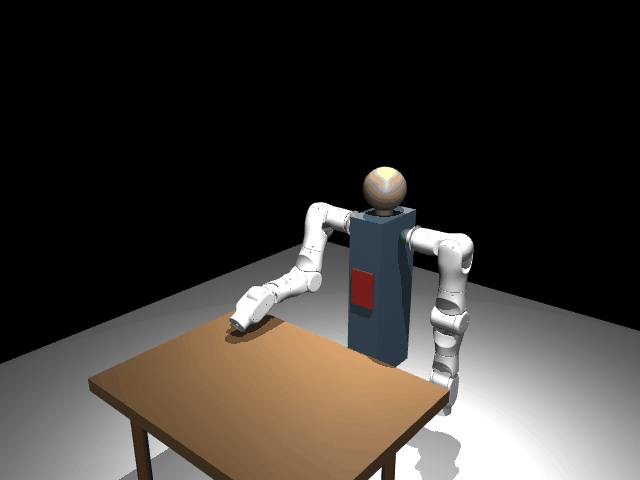
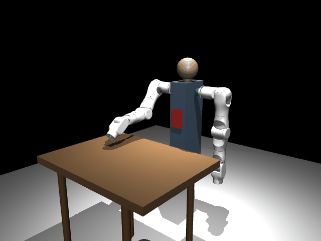
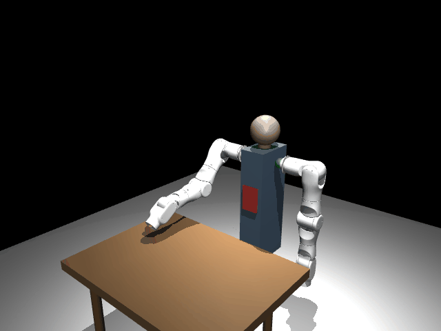
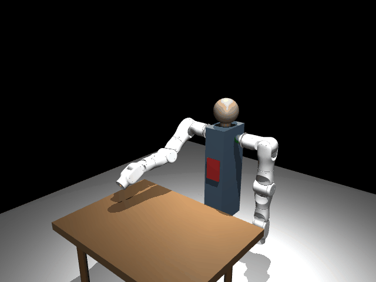
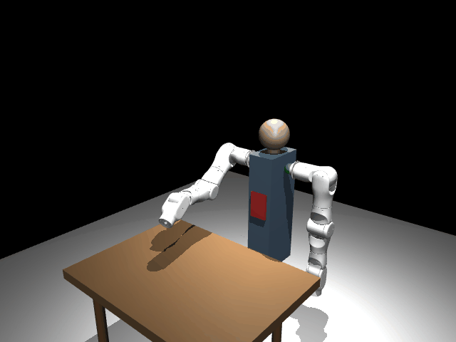
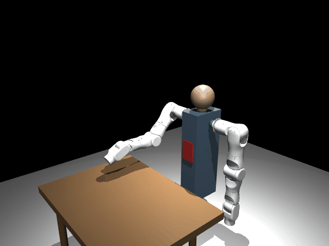
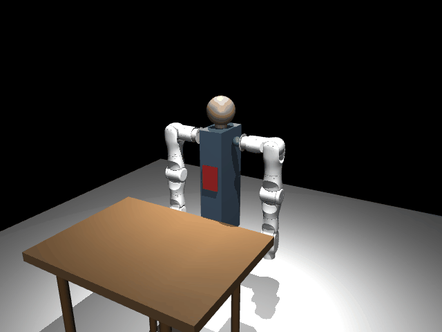

# onero SDK

English | **[中文](README.md)**

Python SDK for controlling onero A1 robotic arms.

## Features

- High-level motion API: `movej`, `movel`, `movep`, `movec`, `servoj`, `servop`
- Multiple trajectory profiles: cosine, trapezoidal, S-curve (jerk-limited)
- Velocity control: `speedj`, `speedl`
- Freedrive / teach mode (gravity compensation via pinocchio)
- Force control: hybrid force/position mode
- Dynamics primitives: Jacobian, gravity torque, Coriolis torque
- Dynamics calibration (parameter identification)
- Kinematic calibration (single-point constraint, improves absolute accuracy)
- Collision detection and external wrench estimation
- Advanced trajectory planning: Ruckig (online jerk-limited), TOPP-RA (time-optimal)
- Configurable payload (affects dynamics accuracy)
- Trajectory recording and replay
- Multi-waypoint trajectories with blending
- Pluggable backend architecture (real CAN hardware or MuJoCo simulation)
- MuJoCo dual-arm simulation with human-like torso
- End effector support (grippers, dexterous hands)
- Built-in safety limits (velocity clamping, joint limits, timeout protection)
- Model registry — create an arm with just a name and channel
- Lightweight FK from URDF (zero external dependencies)
- Optional IK via pinocchio / pink
- Direct SocketCAN communication

## Install

```bash
pip install -e .              # core (CAN + FK + motor control)
pip install -e ".[ik]"        # + inverse kinematics (pinocchio, pink)
pip install -e ".[dynamics]"  # + dynamics (freedrive, force mode)
pip install -e ".[sim]"       # + MuJoCo simulation
pip install -e ".[trajectory]" # + advanced planning (Ruckig, TOPP-RA)
pip install -e ".[full]"      # everything
```

## Quick Start

### Joint Motion (movej)

**What it does**: `movej` moves all joints simultaneously to target angles. The trajectory is planned in joint space with synchronized arrival — all joints start and stop together.

**When to use**: When you only care about the final joint configuration and don't need to control the end-effector path. Examples: moving between workstations, homing, switching to a prep pose.

**Demo**: The arm moves from its initial position to target joint angles with a smooth joint-space interpolation.

<p align="center"></p>

```python
from onero_sdk import Arm

with Arm("A1", channel="can0") as arm:
    # Specify duration directly
    arm.movej([0.0, 0.5, 0.0, -0.3, 0.0, 0.0, 0.0], duration=3.0)

    # Or specify speed/acceleration (UR-compatible style)
    arm.movej([0.3, 0.8, 0.0, -0.5, 0.0, 0.0, 0.0], speed=1.5, acceleration=1.4)

    arm.home()
```

### Straight-Line Motion (movel)

**What it does**: `movel` moves the end-effector along a straight line in Cartesian space to a target pose. The IK solver computes joint angles in real-time to ensure the end-effector follows an exact straight-line path.

**When to use**: When the end-effector path must be a straight line. Examples: glue dispensing, spot welding, assembly insertion, pick-and-place translation phases, and any task requiring precise Cartesian path control.

**Demo**: The end-effector moves in a clear straight line from current position to target.

<p align="center"></p>

```python
import numpy as np
from onero_sdk import Arm

with Arm("A1", channel="can0") as arm:
    # With duration
    arm.movel(position=[0.3, 0.0, 0.2], rotation=np.eye(3), duration=3.0)

    # With tool speed (m/s) — duration auto-computed
    arm.movel([0.3, 0.1, 0.3, 0, 0, 0], speed=0.25, acceleration=1.2)
```

### Real-Time Servo Control (servoj)

**What it does**: `servoj` is a non-blocking real-time joint control interface. Each call sends one frame of target joint angles. Call it at control frequency (100Hz/200Hz) to execute any custom trajectory.

**When to use**: When you need to compute your own trajectory and stream joint targets frame-by-frame. Examples: visual servoing, force feedback real-time adjustment, custom interpolation algorithms, closed-loop control with external sensors. This is the most flexible low-level control interface.

**Demo**: Joint angles are computed from a sine function in real-time, tracing a clear sinusoidal wave at the end-effector.

<p align="center"></p>

```python
import time, math
from onero_sdk import Arm

arm = Arm("A1", channel="can0")
arm.enable()

try:
    for step in range(500):
        t = step / 100.0
        joints = [0.0] * 7
        joints[1] = 0.5 * math.sin(2 * math.pi * 0.5 * t)
        arm.servoj(joints)
        time.sleep(1/100)
finally:
    arm.disable()
```

### Velocity Control (speedj / speedl)

**What it does**: `speedj` and `speedl` control joint velocities and Cartesian velocities respectively. The arm smoothly accelerates to the target velocity and decelerates to stop after the specified duration.

**When to use**: When you need to control motion speed rather than position. Examples: conveyor tracking (match belt speed), continuous feed machining, constant-speed scanning, and velocity-synchronized cooperative tasks.

**Demo**: A joint moves at constant velocity with smooth acceleration/deceleration ramps.

<p align="center"></p>

```python
from onero_sdk import Arm

with Arm("A1", channel="can0") as arm:
    # Move joint 1 at 0.5 rad/s for 3 seconds (with acceleration ramp)
    arm.speedj([0.0, 0.5, 0.0, 0.0, 0.0, 0.0, 0.0], acceleration=1.0, duration=3.0)

    # Cartesian velocity (requires dynamics)
    arm.speedl([0.0, 0.0, -0.05, 0.0, 0.0, 0.0], acceleration=0.5, duration=2.0)
```

### Freedrive (Teach Mode) + Recording & Replay

**What it does**: Freedrive uses gravity compensation to make the arm feel "weightless" — a user can guide it by hand to any pose. Combined with recording/replay, it enables "teach once, execute forever" programming. Supports constrained freedrive (e.g., only allow Z-axis motion) and variable-speed replay.

**When to use**: When the desired trajectory is complex and hard to describe with coordinates. Examples: process teaching (spray painting paths, grinding trajectories), flexible assembly path planning, robot learning data collection, and rapid programming by non-experts.

**Demo**: The arm enters freedrive mode and records a trajectory, then replays it at 1x speed, then at 2x speed — three trails showing the fidelity of record/replay.

<p align="center"></p>

```python
import time
from onero_sdk import Arm

arm = Arm("A1", channel="can0")
arm.enable()

# Record while in freedrive (all axes free)
arm.start_recording()
arm.freedrive_enable(damping=0.3)
time.sleep(10.0)  # user guides the arm
arm.freedrive_disable()
recording = arm.stop_recording()

# Save and replay
recording.save("trajectory.json")
arm.replay(recording, speed_factor=1.0)

# Constrained freedrive: only allow Z-axis movement
arm.freedrive_enable(damping=0.5, free_axes=[0, 0, 1, 0, 0, 0])

arm.disable()
```

### Multi-Segment Trajectory Blending

**What it does**: Blending enables smooth, pause-free transitions between waypoints. Instead of stopping at each waypoint, the arm uses quintic polynomials to create smooth transitions near waypoints, maintaining continuous velocity and acceleration. Supports seamless transitions between linear segments, arcs, and even real-time servo segments.

**When to use**: When you need continuous multi-segment motion without stopping at waypoints. Examples: welding paths (continuous multi-seam), spray painting (no pausing at corners), palletizing (smooth transitions between stations), and any cycle-time-sensitive production applications.

**Demo**: A linear→arc→linear three-segment continuous motion with smooth, pause-free transitions between segments.

<p align="center"></p>

```python
from onero_sdk import Arm, TrajectoryPlanner, Waypoint

planner = TrajectoryPlanner(num_joints=7, control_freq=100.0)
planner.add_waypoint(Waypoint(joints=[0.0, 0.5, 0.0, -0.3, 0.0, 0.0, 0.0], duration=2.0, blend=0.3))
planner.add_waypoint(Waypoint(joints=[0.3, 0.8, 0.2, -0.5, 0.0, 0.1, 0.0], duration=2.0, blend=0.3))
planner.add_waypoint(Waypoint(joints=[0.0, 0.0, 0.0, 0.0, 0.0, 0.0, 0.0], duration=2.0))

with Arm("A1", channel="can0") as arm:
    frames = planner.compute(arm.state.joints)
    arm.execute_trajectory(frames)
```

### Force Mode (Hybrid Force/Position Control)

**What it does**: `force_mode` implements hybrid force/position control. You specify which directions are force-controlled (apply constant force) and which are position-controlled (hold position). The arm continuously applies the specified force in force directions while maintaining position in the others.

**When to use**: When the end-effector must maintain constant contact force with the environment. Examples: grinding/polishing (constant pressure), assembly pressing (specific insertion force), surface probing (light contact to determine position), deburring (slide along surface while maintaining normal force).

**Demo**: The end-effector pushes down with force until contacting a surface, then slides in X/Y while maintaining constant Z-force.

<p align="center"></p>

```python
import time
from onero_sdk import Arm

arm = Arm("A1", channel="can0")
arm.enable()

try:
    # Press down with 10N in z, hold position in x/y
    # task_frame: reference frame for force directions [x, y, z, rx, ry, rz]
    # limits: speed cap in force-controlled directions (m/s, rad/s)
    for _ in range(1000):
        arm.force_mode(
            selection=[0, 0, 1, 0, 0, 0],       # z = force control
            wrench=[0, 0, -10.0, 0, 0, 0],       # 10N downward
            task_frame=[0, 0, 0, 0, 0, 0],       # base frame
            limits=[0, 0, 0.1, 0, 0, 0],         # max 0.1 m/s in z
        )
        time.sleep(1/100)

    arm.force_mode_disable()
finally:
    arm.disable()
```

### Circular Arc Motion (movec)

**What it does**: `movec` moves the end-effector along a circular arc path. Three points define the arc: start (current pose), via point, and target. The IK solver computes joint angles in real-time to ensure the end-effector traces a precise arc.

**When to use**: When the end-effector path must follow a circular arc. Examples: arc welding (curved seams), polishing curved surfaces, circular glue dispensing, pipe tracking, and any machining requiring curved paths.

**Demo**: The end-effector follows a clear circular arc trajectory, demonstrating precise three-point arc fitting.

<p align="center"></p>

```python
from onero_sdk import Arm

arm = Arm("A1", channel="can0")
arm.enable()

try:
    # Move end-effector along a circular arc
    # Pose format: [x, y, z, rx, ry, rz] (meters, rotation vector in rad)
    via_pose = [0.3, 0.1, 0.4, 0, 0, 0]
    target_pose = [0.3, -0.1, 0.4, 0, 0, 0]

    arm.movec(via_pose, target_pose, duration=3.0)
finally:
    arm.disable()
```

### Collision Detection

**What it does**: Real-time monitoring of joint torque anomalies. Compares actual motor torques against dynamics model predictions — the difference indicates external contact forces.

**When to use**: When the arm operates in shared workspaces where it may contact people or obstacles. Examples: human-robot collaboration safety, autonomous exploration in unknown environments, preventing damage to workpieces or tools.

```python
from onero_sdk import Arm
from onero_sdk.safety import SafetyConfig

# Configure collision threshold (Nm)
safety = SafetyConfig(collision_threshold=5.0, collision_stop=True)
arm = Arm("A1", channel="can0", safety=safety)
arm.enable()

# Manual check (useful when collision_stop=False)
collision = arm.check_collision()
if collision:
    print("External contact detected!")
```

### Payload Configuration

**What it does**: Informs the SDK about tool/workpiece mass attached to the end-effector, allowing the dynamics model to correctly compensate for the additional load.

**When to use**: After mounting a gripper, tool, or grasping a workpiece. Ensures freedrive feels natural and collision detection remains accurate under load.

```python
from onero_sdk import Arm

arm = Arm("A1", channel="can0")
arm.enable()

# Set tool payload for accurate dynamics
# (affects freedrive, collision detection, external force estimation)
arm.set_payload(mass=0.5, cog=[0.0, 0.0, 0.05])
```

### External Wrench Estimation

**What it does**: Estimates 6-DOF external force/torque at the end-effector without a dedicated force sensor. Computed from the difference between measured motor currents and dynamics model predictions.

**When to use**: When you need force sensing but don't have a force/torque sensor installed. Examples: contact detection, simple force-guided interaction, monitoring process forces.

```python
from onero_sdk import Arm

arm = Arm("A1", channel="can0")
arm.enable()

# Estimate external force/torque at end-effector
wrench = arm.get_external_wrench()
# wrench = [fx, fy, fz, tx, ty, tz] in N and Nm
print(f"Force: {wrench[:3]}, Torque: {wrench[3:]}")
```

### Impedance Control (Dynamics Primitives)

**What it does**: The SDK provides dynamics primitives (Jacobian, gravity torques, Coriolis torques) for implementing Cartesian impedance control. This makes the arm behave like a spring — it deflects under external forces and automatically returns, with tunable stiffness.

**When to use**: When the arm must interact compliantly with the environment. Examples: compliant assembly (tolerating part misalignment), safe human-robot collaboration, force-adaptive tasks like polishing/wiping, and any advanced control requiring custom dynamic behavior.

**Demo**: The arm holds a target pose with low stiffness. External perturbation causes visible deflection, followed by spring-like recovery.

<p align="center"></p>

```python
import numpy as np
from onero_sdk import Arm

arm = Arm("A1", channel="can0")
arm.enable()

# End-effector Jacobian (6x7) in world frame
J = arm.jacobian()

# Gravity compensation torques
g = arm.gravity_torque()

# Coriolis + centrifugal torques (near-zero at rest)
c = arm.coriolis_torque()

# Example: Cartesian impedance control
Kp = np.diag([200, 200, 200, 50, 50, 50])
Kd = np.diag([20, 20, 20, 5, 5, 5])
x_error = x_desired - x_current   # 6D pose error
dx_error = dx_desired - dx_current # 6D velocity error
F = Kp @ x_error + Kd @ dx_error
tau = J.T @ F + np.array(g)
arm.servoj(arm.state.joints, kp=0, kd=0, tau_ff=tau.tolist())
```

### 7-DOF Null-Space Motion

**What it does**: The A1 is a 7-DOF arm operating in 6D task space (3 translation + 3 rotation), giving it 1 redundant degree of freedom. Null-space motion exploits this redundancy: the arm reconfigures its posture while the end-effector stays perfectly fixed. Implemented via the Jacobian null-space projector — any joint velocity projected into the null-space produces zero end-effector motion.

**When to use**: When you need to change the arm's configuration without moving the end-effector. Examples: obstacle avoidance (move elbow away from obstacles), singularity avoidance (improve manipulability), joint limit avoidance (move joints away from limits), self-collision avoidance in multi-arm setups, and maneuvering in confined spaces.

**Demo**: The end-effector (green dot) remains perfectly stationary while the elbow (magenta trail) sweeps over 200mm, demonstrating that one end-effector pose corresponds to infinitely many arm configurations.

<p align="center"></p>

```python
import numpy as np
from onero_sdk import Arm

arm = Arm("A1", channel="can0")
arm.enable()

dynamics = arm._get_dynamics()
fk = arm._get_fk()
ik = arm._get_ik()

# Lock current EE pose as target
ee_target_pos, ee_target_rot = fk.get_ee_pose(arm.state.joints)
q_current = np.array(arm.state.joints)

# Null-space excitation direction
q_excite = np.array([0.4, -0.3, 1.2, 0.3, -1.0, 0.15, 0.6])
dt = 0.005

for step in range(3000):
    t = step * dt
    amplitude = 4.0 * np.sin(2 * np.pi * 0.12 * t)

    # Null-space projector: N = I - J_pinv @ J
    J = dynamics.jacobian(list(q_current))
    J_pinv = np.linalg.pinv(J)
    N = np.eye(7) - J_pinv @ J
    dq_null = N @ (q_excite * amplitude)

    q_candidate = q_current + dq_null * dt

    # IK correction: ensure EE stays exactly at target pose
    ik.reset(q_candidate)
    q_current = np.array(ik.solve(ee_target_pos, ee_target_rot, dt=dt))

    arm.servoj(list(q_current))

arm.disable()
```

### Dynamics Calibration

**What it does**: Identifies friction parameters and load offsets by collecting torque data across multiple static configurations. After calibration, gravity compensation, collision detection, and force estimation accuracy improve significantly.

**When to use**: When commissioning a new arm, after replacing joints/gearboxes, or when freedrive mode shows noticeable "drift." Typically done once; results persist.

```python
from onero_sdk import Arm

arm = Arm("A1", channel="can0")
arm.enable()

# Calibrate dynamics parameters (improves gravity comp accuracy)
result = arm.calibrate_dynamics(num_configs=40, settle_time=0.5)
print(f"RMS residual: {result.residual_rms:.4f} Nm")
print(f"Coulomb friction: {result.friction_coulomb}")

# After calibration, freedrive / force estimation becomes more accurate
arm.disable()
```

### Kinematic Calibration (Absolute Accuracy)

**What it does**: Solves for joint offsets and link parameter errors by touching a known reference point from multiple arm configurations. After calibration, FK/IK absolute positioning accuracy improves from millimeter to sub-millimeter level.

**When to use**: When high absolute positioning accuracy is required. Examples: multi-arm cooperation (coordinate frames must align), vision-guided grasping (end-effector must reach exact coordinates after camera calibration), precision assembly.

```python
from onero_sdk import Arm, KinematicCalibrator

arm = Arm("A1", channel="can0")
arm.enable()

# Touch a fixed reference point (e.g. table corner) from different arm configs
calibrator = KinematicCalibrator.from_arm(arm)
for i in range(20):
    input(f"Touch reference point (config {i+1}/20), press Enter")
    calibrator.record_touch(arm=arm)

# Solve for kinematic corrections
result = calibrator.solve()
print(f"Residual: {result.residual_mm:.2f} mm")
result.save("kinematic_cal.json")

# Apply — all subsequent FK/IK use corrected parameters
arm.apply_kinematic_calibration(result)

arm.disable()
```

### Advanced Trajectory Planning

**What it does**: The SDK supports multiple industrial-grade trajectory profiles. Trapezoidal is the industry standard (constant acceleration/deceleration); S-curve limits jerk for smoother motion; Ruckig supports online real-time re-planning; TOPP-RA computes time-optimal trajectories.

**When to use**: When you need precise control over velocity profiles or need to minimize motion time. Examples: high-speed pick-and-place needs trapezoidal for efficiency, precision operations need S-curve to reduce vibration, dynamic tracking needs Ruckig for online re-planning, multi-waypoint time-optimal paths need TOPP-RA.

**Demo**: A large joint motion using trapezoidal velocity profile showing clear acceleration-cruise-deceleration phases.

<p align="center"></p>

```python
from onero_sdk import Arm, TrapezoidalProfile, RuckigPlanner, TimeOptimalPlanner

arm = Arm("A1", channel="can0")
arm.enable()

# 1. Trapezoidal / S-curve profile (built-in, no extra deps)
arm.movej(target, speed=2.0, acceleration=5.0)                # trapezoidal (auto)
arm.movej(target, speed=2.0, acceleration=5.0, profile='s_curve')  # jerk-limited

# 2. Ruckig — online jerk-limited (pip install ruckig)
planner = RuckigPlanner(num_joints=7)
planner.set_limits(v_max=[2.5]*7, a_max=[5.0]*7, j_max=[30.0]*7)
frames = planner.plan(start, target, dt=0.01)
arm.execute_trajectory(planner.to_trajectory_frames(frames, dt=0.01))

# 3. TOPP-RA — time-optimal through waypoints (pip install toppra)
opt = TimeOptimalPlanner(num_joints=7)
opt.set_velocity_limits([2.5]*7)
opt.set_acceleration_limits([5.0]*7)
frames = opt.plan(waypoints, dt=0.01)  # fastest path within constraints
arm.execute_trajectory(frames)

arm.disable()
```

### MuJoCo Simulation

**What it does**: The SDK's backend architecture is fully pluggable. The MuJoCo simulation backend provides the same interface as the real hardware backend — all high-level APIs (movej, movel, force_mode, etc.) run in simulation without any code changes. Switch to real hardware by only changing the backend.

**When to use**: Development and debugging without a physical arm; algorithm validation and parameter tuning; teaching demonstrations; CI/CD automated testing.

```python
from onero_sdk.dual_mujoco_backend import DualMujocoBackend
import mujoco.viewer

# Dual-arm simulation with human-like torso + desk
backend = DualMujocoBackend(model_name='A1', realtime=True)
viewer = mujoco.viewer.launch_passive(backend._model, backend._data)
backend._viewer = viewer

# Symmetric motion: opposite joint signs = mirror movement
import numpy as np
r_forward = np.array([1.5, 0, 0, 0, 0, 0, 0])
l_forward = -r_forward  # mirror
backend.movej(r_forward, l_forward, duration=2.0)
```

### Dual Arm

**What it does**: `DualArm` wraps coordinated dual-arm control with shared time synchronization, safety monitoring, and lifecycle management. Supports symmetric motion, independent motion, and coordinated tasks.

**When to use**: When two arms must work together. Examples: cooperative handling of large workpieces, one arm holding while the other operates, symmetric actions (e.g., twisting a cap), and tasks requiring inter-arm collision avoidance.

**Demo**: Two arms execute mirror-symmetric motion, demonstrating synchronized dual-arm coordination.

<p align="center"></p>

```python
from onero_sdk import DualArm

with DualArm.create("A1", left_channel="can0", right_channel="can1") as dual:
    dual.movej(
        left_joints=[0.0, 0.5, 0.0, -0.3, 0.0, 0.0, 0.0],
        right_joints=[0.0, -0.5, 0.0, 0.3, 0.0, 0.0, 0.0],
        duration=3.0,
    )
```

### End Effector (Gripper / Dexterous Hand)

**What it does**: The SDK provides abstract interfaces (`Gripper`, `DexterousHand`) that bind end-effector lifecycle to the arm. Implement the communication protocol for your hardware and get automatic enable/disable management with a unified API.

**When to use**: When a gripper or dexterous hand is mounted. The SDK is hardware-agnostic — adapt any protocol (CAN, RS485, EtherCAT, etc.) by subclassing the abstract base class.

```python
from onero_sdk import Arm, Gripper
from onero_sdk.can_bus import CanBus

class MyGripper(Gripper):
    def __init__(self, bus, can_id=0x08):
        self._bus = bus
        self._can_id = can_id
        self._pos = 0xFF

    def enable(self):    self.open()
    def disable(self):   pass
    def shutdown(self):  pass
    def open(self):      self._send(0xFF)
    def grasp(self):     self._send(0x00)
    def set_position(self, position: float):
        self._send(int(position * 0xFF))
    def get_position(self) -> float:
        return self._pos / 0xFF
    def _send(self, pos):
        data = bytes([0x00, pos, 0xFF, 0x80, 0xFF, 0xFF, 0x00, 0x00])
        self._bus.send(self._can_id, data)
        self._pos = pos

# Attach to arm — enable/disable managed automatically
bus = CanBus("can0")
gripper = MyGripper(bus, can_id=0x08)

with Arm("A1", channel="can0", end_effector=gripper) as arm:
    arm.movej([0.0, 0.8, 0.0, -1.0, 0.0, 0.5, 0.0], duration=2.0)
    arm.gripper.open()
    arm.movej([0.0, 1.0, 0.0, -1.2, 0.0, 0.5, 0.0], duration=1.5)
    arm.gripper.grasp()
```

See `examples/gripper_pick_place.py` for a full pick-and-place workflow.

## Hardware Setup

### 1. USB-CAN adapter permissions (one-time)

```bash
sudo cp configs/99-onero-can.rules /etc/udev/rules.d/
sudo udevadm control --reload-rules && sudo udevadm trigger
sudo usermod -aG dialout,plugdev $USER
sudo setcap cap_net_admin+ep $(which slcand)
sudo setcap cap_net_admin+ep $(which ip)
# Log out and back in
```

### 2. Start CAN interfaces

```bash
# Using the provided scripts:
# Usage: onero-can-up.sh [device] [channel] [bitrate]
#   device:  serial device path (default: /dev/ttyACM0)
#   channel: CAN interface name (default: can0)
#   bitrate: slcand speed flag (default: s8 = 1Mbit/s)
#            s4=125k, s5=250k, s6=500k, s7=800k, s8=1M
sudo bash configs/onero-can-up.sh                           # defaults: /dev/ttyACM0 can0 s8
sudo bash configs/onero-can-up.sh /dev/ttyACM1 can1 s8     # second arm on can1

# Or manually:
sudo slcand -o -s8 /dev/ttyACM0 can0 && sudo ip link set up can0
```

## Configuration

Minimal config (`configs/a1.yaml`):

```yaml
model: "A1"
channel: "can0"
```

Or create directly in code:

```python
arm = Arm("A1", channel="can0")
arm = Arm.from_config("configs/a1.yaml")
```

## Architecture

```
onero_sdk/
├── arm.py              # High-level API (movej/movel/speedj/freedrive/force_mode/...)
├── dual_arm.py         # DualArm convenience wrapper
├── backend.py          # ArmBackend ABC (pluggable transport)
├── can_backend.py      # CAN hardware backend implementation
├── safe_backend.py     # SafeBackend decorator — transparent safety clamping at backend seam
├── motion_executor.py  # MotionExecutor — unified control loop for frame generators
├── clock.py            # ControlClock — deadline-based timing with drift compensation
├── geometry.py         # Pure math (SLERP, rotation vectors, circle fitting, Rodrigues)
├── end_effector.py     # EndEffector / Gripper / DexterousHand ABCs
├── trajectory.py       # Recording, TrajectoryPlanner, blending (quintic)
├── trajectory_profiles.py # Trapezoidal, S-curve, quintic blend profiles
├── ruckig_planner.py   # Online jerk-limited trajectory (Ruckig) [optional]
├── toppra_planner.py   # Time-optimal path parameterization (TOPP-RA) [optional]
├── dynamics.py         # Dynamics model (pinocchio RNEA + Jacobian) [optional]
├── calibration.py      # Dynamics parameter identification [optional]
├── kinematic_calibration.py # Kinematic calibration (single-point) [optional]
├── mujoco_backend.py   # Single-arm MuJoCo simulation backend [optional]
├── dual_mujoco_backend.py # Dual-arm MuJoCo simulation with torso [optional]
├── fk.py              # Lightweight FK from URDF (numpy only)
├── ik_solver.py        # IK: DLS (pinocchio) + QP (pink) [optional]
├── safety.py           # Safety limits and timeout protection
├── model_registry.py   # Arm model → joint config lookup
├── exceptions.py       # OneroError hierarchy
├── protocol.py         # CAN frame encode/decode
├── can_bus.py          # SocketCAN raw socket
├── motor.py            # Single motor controller (low-level)
└── config.py           # YAML config loading
```

## Motion API

| Command | Space | Mode | Blocking | Use Case |
|---------|-------|------|----------|----------|
| `movej` | Joint | Position | Yes | Fast joint motion |
| `movel` | Cartesian | Position | Yes | Straight-line (assembly, gluing) |
| `movep` | Cartesian | Position | Yes | Reach a pose, any path |
| `movec` | Cartesian | Position | Yes | Circular arc (welding, polishing) |
| `speedj` | Joint | Velocity | Yes | Constant joint velocity |
| `speedl` | Cartesian | Velocity | Yes | Constant EE velocity |
| `servoj` | Joint | Real-time | No | Real-time joint control |
| `servop` | Cartesian | Real-time | No | Real-time Cartesian control |
| `freedrive_step` | — | Torque | No | Manual guidance (per frame) |
| `force_mode` | Cartesian | Force | No | Hybrid force/position |

Motion commands (`movej`, `movel`, `movec`, `movep`) support two parameter styles:
- **Duration style**: `arm.movej(target, duration=3.0)` — specify total time
- **Speed style** (UR-compatible): `arm.movej(target, speed=1.5, acceleration=1.4)` — specify max speed, duration is auto-computed from trapezoidal profile

Default profile is **trapezoidal** (industry standard). Use `profile='cosine'` for legacy behavior or `profile='s_curve'` for jerk-limited smoothness.

## Low-level API

For hardware debugging or custom control modes:

```python
from onero_sdk import CanBus, Motor, MotorLimits

with CanBus("can0") as bus:
    motor = Motor(bus, can_id=0x01, mst_id=0x11,
                  limits=MotorLimits(p_max=12.5, v_max=30.0, t_max=15.0))
    motor.enable()
    state = motor.set_mit(position=1.0, kp=50.0, kd=1.0)
    motor.disable()
```

## Dependencies

- **Required**: `numpy`, `pyyaml`
- **Optional (IK)**: `pin` (pinocchio), `pink`
- **Optional (Dynamics)**: `pin` (pinocchio) — for freedrive, force mode, speedl
- **Optional (Trajectory)**: `ruckig`, `toppra` — for Ruckig and TOPP-RA planning
- **Optional (Sim)**: `mujoco`
- **System**: Linux with SocketCAN support

## Testing

```bash
# Protocol unit tests (no hardware)
python3 tests/test_protocol.py

# Virtual CAN integration test
sudo ip link add dev vcan0 type vcan && sudo ip link set up vcan0
python3 -c "from onero_sdk import Arm; arm = Arm('A1', channel='vcan0'); print('OK')"
```

## Diagnostics

Run the built-in diagnostic tool to verify your setup:

```bash
python -m onero_sdk.diag          # checks can0 by default
python -m onero_sdk.diag can1     # check a specific interface
```

This checks: CAN interface status, URDF files, pinocchio/pink availability.

## Logging

The SDK uses Python's standard `logging` module. Enable debug output to see
control loop internals, CAN frame timing, and safety monitor activity:

```python
import logging
logging.basicConfig(level=logging.DEBUG)

# Or enable only SDK logs:
logging.getLogger("onero_sdk").setLevel(logging.DEBUG)
```

Log levels used:
- `DEBUG`: per-frame timing, CAN frame details
- `INFO`: lifecycle events (enable/disable), motion start/end
- `WARNING`: missed CAN frames (< threshold), near-limit conditions
- `ERROR`: emergency stop triggers, hardware faults

## Examples

- `examples/basic_movej.py` — Move to joint angles
- `examples/basic_movel.py` — Cartesian straight-line motion
- `examples/servo_control.py` — Real-time 100Hz servo loop
- `examples/speed_control.py` — Velocity mode (speedj)
- `examples/freedrive_teach.py` — Freedrive + record + replay
- `examples/blending.py` — Multi-waypoint trajectory with blending
- `examples/gripper_pick_place.py` — Arm + gripper pick-and-place
- `examples/dual_arm.py` — Dual arm control
- `examples/mit_control.py` — Low-level single motor control
- `examples/position_control.py` — Position-velocity mode
- `examples/calibration_demo.py` — Dynamics parameter identification (MuJoCo)
- `examples/kinematic_calibration_demo.py` — Kinematic calibration (single-point method)
- `examples/trajectory_planning_demo.py` — Trajectory profiles comparison (trapezoidal, S-curve, Ruckig, TOPP-RA)
- `examples/mujoco_trajectory_comparison.py` — MuJoCo validation of trajectory profiles (automated checks)
- `examples/dual_arm_mujoco_demo.py` — Dual-arm simulation with torso + desk
