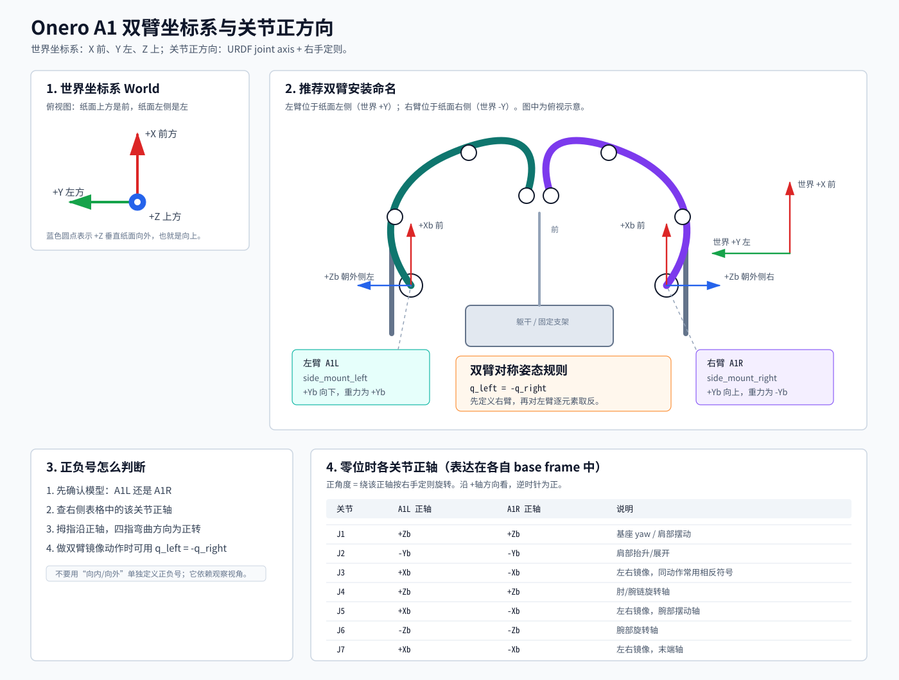

# Onero A1 坐标系与关节正方向

本文说明 A1 单臂/双臂安装时的坐标系、左右臂模型选择，以及 7 个关节正方向的定义。



图中的俯视示意统一按“纸面上方 = 前方（world +X），纸面左侧 = 左方（world +Y）”绘制。

## 推荐表达方式

成熟机械臂文档通常把这几件事分开写：

1. **世界坐标系 / 基座坐标系 / 工具坐标系**：先定义用户编程时看到的 frame。
2. **安装姿态**：说明 base frame 如何映射到 world frame。
3. **关节正方向**：用 URDF joint axis + 右手定则定义，不用“向内/向外”这类依赖视角的说法。
4. **双臂镜像规则**：给一个明确的左右臂姿态映射规则。

## Frame 约定

### World frame

SDK 的世界坐标系采用：

```text
X = forward / 前方
Y = left    / 左方
Z = up      / 上方
```

### Base frame

Base frame 是 URDF 中 `base_link` 的坐标系。笛卡尔 API 默认使用 base frame；如果创建 Arm 时启用 `world_frame=True`，SDK 会自动做 world/base 变换。

```python
arm = Arm("A1R", channel="can0", mounting="side_mount_right", world_frame=True)
arm.movel([0.3, 0.0, 0.2, 0.0, 0.0, 0.0])
```

### Tool / TCP frame

`get_pose()` 默认返回法兰位姿。调用 `set_tcp()` 后，笛卡尔 API 的目标点改为工具尖端。

```python
arm.set_tcp([0.0, 0.0, 0.15])
```

## 双臂安装推荐

推荐把左右臂明确建模为不同模型：

```python
left = Arm("A1L", channel="can0", mounting="side_mount_left",
           world_frame=True, base_position=[0, 0.15, 0])
right = Arm("A1R", channel="can1", mounting="side_mount_right",
            world_frame=True, base_position=[0, -0.15, 0])
```

对应关系：

| 机械臂 | 模型 | 安装预设 | base Z 方向 | base Y 方向 | 重力在 base 中 |
|---|---|---|---|---|---|
| 左臂 | `A1L` | `side_mount_left` | world +Y / 左 | world -Z / 下 | +Y |
| 右臂 | `A1R` | `side_mount_right` | world -Y / 右 | world +Z / 上 | -Y |

## 关节正方向定义

关节正方向由 URDF 决定：每个 revolute joint 的 `<axis xyz="...">` 是该关节的正旋转轴。正角度遵循右手定则：右手拇指指向正轴方向，四指弯曲方向就是正转方向。

下表是从 `onero_sdk/urdf/A1/a1_l.urdf` 和 `onero_sdk/urdf/A1/a1_r.urdf` 计算得到的零位 joint axis，均表达在各自 base frame 下。

| Joint | A1L 正轴 | A1R 正轴 | 说明 |
|---|---:|---:|---|
| J1 | +Zb | +Zb | 肩部/基座 yaw |
| J2 | -Yb | -Yb | 肩部抬升/展开 |
| J3 | +Xb | -Xb | 左右镜像 |
| J4 | +Zb | +Zb | 肘/腕链中的旋转轴 |
| J5 | +Xb | -Xb | 左右镜像 |
| J6 | -Zb | -Zb | 腕部旋转轴 |
| J7 | +Xb | -Xb | 左右镜像 |

## 应该给正还是给负？

单臂控制时，不要靠“从图片看顺时针/逆时针”判断；按下面流程判断：

1. 先确认你在控制 `A1L` 还是 `A1R`。
2. 查上表得到该 joint 的正轴。
3. 沿正轴方向看过去，逆时针就是正角度，顺时针就是负角度。
4. 如果只是做双臂对称动作，优先使用镜像规则：

```python
right_pose = [1.2, -0.5, 0.0, -1.0, 0.0, 0.3, 0.0]
left_pose = [-q for q in right_pose]
```

这条规则与现有双臂 MuJoCo demo 的姿态约定一致：`q_left = -q_right` 表示对称镜像动作。

## 文档中建议统一使用的句式

建议文档里避免写：

```text
J2 正方向是向外展开。
```

因为“向外”依赖安装方向、左右臂、观察视角。建议写成：

```text
J2 的正轴为 base -Y。正角度按右手定则定义。对于双臂对称展开，使用 q_left = -q_right。
```

或者写成用户更容易操作的形式：

```text
如果你在写单臂程序，用 joint-axis 表判断正负；如果你在写双臂对称动作，先定义右臂姿态，再令左臂姿态等于逐元素取反。
```
